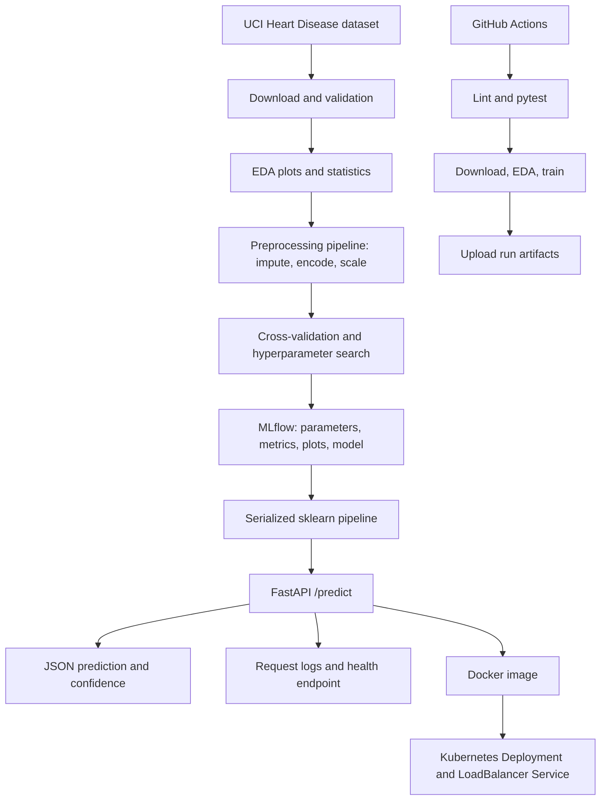

# End-to-End MLOps: Heart Disease Classification

**Course:** Machine Learning Operations (MLOps), AIMLCZG523
**Assignment:** 01
**Dataset:** UCI Heart Disease (UCI repository dataset ID 45)

> **Safety note:** This is an educational classification demonstration, not a clinical decision tool. It must not be used to diagnose, treat, or make care decisions for a person.

## Architecture



## Quick start

Use Python 3.11. From the project root:

```bash
python -m venv .venv
source .venv/bin/activate        # Windows: .venv\\Scripts\\activate
python -m pip install --upgrade pip
pip install -r requirements.txt
python -m src.download_dataset
python -m src.eda
python -m src.train
pytest -q
ruff check src tests
```

The download script uses `ucimlrepo` to retrieve UCI dataset ID 45. Internet access is required for the first data download. The training pipeline converts the original target into binary labels (0 = no disease, 1 = disease present), performs stratified train/test splitting and five-fold stratified cross-validation, tunes Logistic Regression and Random Forest with GridSearchCV, and logs each run to a local SQLite MLflow store (`mlflow.db`) with run artifacts under `mlruns/`.

## Explore MLflow

```bash
mlflow ui --backend-store-uri sqlite:///mlflow.db --host 127.0.0.1 --port 5000
```
Open `http://127.0.0.1:5000`. Each model run logs its search parameters, CV ROC-AUC, holdout metrics, classification report, confusion matrix, ROC curve, and sklearn model artifact. Generated files are placed under `artifacts/`.

## Run the API locally

Training must finish first so `artifacts/model.joblib` exists.

```bash
uvicorn src.api:app --reload --host 0.0.0.0 --port 8000
```

- `GET /health` — service and model status
- `GET /metrics` — lightweight operational status payload (not a full Prometheus exporter)
- `POST /predict` — JSON object with the same feature names as the original dataset
- `GET /docs` — interactive Swagger UI

Example payload (illustrative only; feature names must match the downloaded dataset):

```json
{
  "age": 57, "sex": 1, "cp": 2, "trestbps": 130, "chol": 236,
  "fbs": 0, "restecg": 0, "thalach": 174, "exang": 0,
  "oldpeak": 0.0, "slope": 1, "ca": 0, "thal": 2
}
```

The exact feature schema is taken from the retrieved CSV. The model pipeline handles numeric imputation/scaling and categorical imputation/one-hot encoding. The API logs request method, path, status, and latency; it intentionally does not log patient payload values.

## Docker

```bash
python -m src.download_dataset
python -m src.train
docker build -t heart-disease-api:latest .
docker run --rm -p 8000:8000 heart-disease-api:latest
curl http://localhost:8000/health
```
Or use `docker compose up --build`. Build only after the trained model artifact exists. Do not commit real patient information or secrets.

The hosted workflow also builds this image, starts the container, and checks `/health` and `/predict` with the sample payload. The successful run and its response/log evidence are linked below. Docker is not installed on the local Mac workspace, so that run used GitHub's Linux runner.

## Kubernetes (local Minikube / Docker Desktop)

Build the image into the local cluster's image store. For Minikube:

```bash
minikube start
eval $(minikube docker-env)
docker build -t heart-disease-api:latest .
kubectl apply -f k8s/deployment.yaml
kubectl rollout status deployment/heart-disease-api
kubectl get pods,svc
```
For Docker Desktop Kubernetes, build the image locally and ensure the cluster can access it. `LoadBalancer` behavior depends on the local cluster; for Minikube use `minikube service heart-disease-api`. On cloud Kubernetes, push the image to a registry and replace `image:` with the registry URI before applying the manifest. Never publish a public endpoint with real personal health data.

## CI/CD

`.github/workflows/ci.yml` runs linting, unit tests, data download, EDA, model training, Docker build/container smoke checks, and artifact upload on pushes, pull requests, and manual dispatch. [MLOps CI run #6](https://github.com/SakshiShirude/mlops-assignment-01-heart-disease/actions/runs/39113734951) passed, including container `/health` and `/predict`. Dataset retrieval needs outbound network access; failed lint, test, training, or container checks fail the workflow.

## Monitoring

The API emits structured operational log fields for each request and offers `/health` and `/metrics`. These provide a lightweight baseline; a production deployment should export Prometheus metrics (request count, latency histogram, error count, model version) and connect a Grafana dashboard. Do not interpret the provided `/metrics` JSON endpoint as a full Prometheus exposition endpoint.

## Deliverable evidence checklist

- [x] EDA plots and model metrics were generated under `artifacts/`.
- [x] Local MLflow run/metric and FastAPI screenshots are in `screenshots/`.
- [x] Local pytest and Ruff checks passed; hosted GitHub Actions run #6 passed (see `screenshots/docker_container_ci_run.png`).
- [x] GitHub Actions built and ran the Docker container; response bodies and container logs are saved under `screenshots/`.
- [x] Capture `kubectl get pods,svc` and Kubernetes deployment verification (see `screenshots/k8s_deployment.png`).
- [ ] Record the requested short pipeline video.
- [x] GitHub repository: https://github.com/SakshiShirude/mlops-assignment-01-heart-disease. Local and Prayogshala API instructions are provided above.

The repository is published at https://github.com/SakshiShirude/mlops-assignment-01-heart-disease. Docker containerization was verified locally and on GitHub Actions; Kubernetes deployment was completed and verified using Minikube on BITS Prayogshala and Docker Desktop locally.
